<!-- datasheet:banner -->
<p align="center">
  <picture>
    <source media="(prefers-color-scheme: dark)" srcset=".github/assets/banner-dark.svg">
    
  </picture>
</p>
<!-- /datasheet:banner -->

# Speaches Audio Engine (Kokoro-82M TTS + Faster-Whisper STT) for Odysseus

A unified, local, OpenAI-compatible audio engine running in Docker. Powered by:
- **Kokoro-82M ONNX**: Studio-quality neural text-to-speech with natural prosody.
- **Faster-Whisper (Systran/faster-whisper-small)**: Fast, memory-efficient local speech-to-text transcription.
- **Odysseus Integration**: Directly integrated into the Odysseus AI Workspace for agent voice responses and user speech transcription.
- **Document Narrator (`narrator.py`)**: Universal document reader capable of reading PDFs, Markdown, EPUBs, and plain text files aloud to MP3 audiobooks with live macOS playback.

---

<!-- datasheet:figure -->
## At a glance

<p align="center">
  <picture>
    <source media="(prefers-color-scheme: dark)" srcset=".github/assets/diagram-dark.svg">
    
  </picture>
</p>

| Characteristic | Detail |
| --- | --- |
| **Text-to-speech** | Kokoro-82M (ONNX), studio-quality neural voices with natural prosody |
| **Speech-to-text** | Faster-Whisper (`Systran/faster-whisper-small`), local and memory-efficient |
| **API** | OpenAI-compatible, served by the Speaches container at `http://localhost:8000/v1` |
| **Tools** | `narrator.py` reads PDF, Markdown, EPUB and text aloud to MP3; `pdf2epub_tts.py` builds chaptered M4B audiobooks |
| **Verification** | `verify_all.py` and `test_audio_engine.py` check the engine end to end |
<!-- /datasheet:figure -->

## 1. Quick Start & Docker Compose

### Start / Stop the Container
```bash
cd ~/Documents/Docker/Speaches

# Start the audio engine
docker compose up -d

# View real-time logs
docker logs -f speaches

# Stop the container
docker compose down
```

### Endpoints
- **Host Web UI**: [http://localhost:8000/](http://localhost:8000/)
- **Models List**: `GET http://localhost:8000/v1/models`
- **Text-to-Speech (TTS)**: `POST http://localhost:8000/v1/audio/speech`
- **Speech-to-Text (STT)**: `POST http://localhost:8000/v1/audio/transcriptions`
- **Docker Internal Network (Odysseus)**: `http://speaches:8000/v1`

---

## 2. Odysseus AI Workspace Integration

Speaches is registered in the Odysseus SQLite database (`data/app.db`) as a unified `ModelEndpoint` and configured in `data/settings.json`.

To re-apply or verify Odysseus settings at any time:
```bash
python3 setup_speaches_odysseus.py
```

### Configured Settings:
- **TTS Provider**: `endpoint:speaches_audio_engine`
- **TTS Model**: `speaches-ai/Kokoro-82M-v1.0-ONNX`
- **TTS Voice**: `af_heart` (options: `af_bella`, `am_adam`, `bf_emma`, `bm_george`, etc.)
- **STT Provider**: `endpoint:speaches_audio_engine`
- **STT Model**: `Systran/faster-whisper-small`

---

## 3. Document Narrator Tool (`narrator.py`)

`narrator.py` extracts text cleanly, intelligently segments sentences to preserve Kokoro's natural prosody, synthesizes speech chunks, and stitches them into a final MP3 file.

### CLI Usage

```bash
# Narrate a Markdown file
./narrator.py test_docs/sample.md -o narration.mp3

# Narrate a PDF document (specific pages)
./narrator.py document.pdf --start-page 1 --end-page 5 -o output.mp3

# Narrate an EPUB book with a British female voice
./narrator.py book.epub -v bf_emma -o audiobook.mp3

# Narrate a text file and play aloud immediately (macOS afplay)
./narrator.py notes.txt --play
```

### CLI Flags:
- `file`: Path to `.pdf`, `.md`, `.epub`, or `.txt` file.
- `-o, --output`: Destination MP3 file path.
- `-v, --voice`: Kokoro voice ID (e.g. `af_heart`, `af_bella`, `am_adam`, `bf_emma`, `bm_george`).
- `-s, --speed`: Speech speed multiplier (e.g. `1.0`, `1.15`).
- `--start-page / --end-page`: Page range (PDF only).
- `-p, --play`: Play audio aloud through system speakers immediately after synthesis.

### Python API Example:
```python
from narrator import DocumentNarrator

narrator = DocumentNarrator(base_url="http://localhost:8000/v1", voice="af_heart")
audio_path = narrator.narrate_document(
    file_path="report.pdf",
    output_path="report.mp3",
    play_live=True
)
print(f"Generated: {audio_path}")
```

---

## 4. PDF to Chaptered M4U/M4B Audiobook Generator (`pdf2epub_tts.py`)

A high-performance script located at `~/Documents/pdf2epub_tts.py` that strips PDF artifacts, detects chapter boundaries, and uses your Docker Kokoro engine (`http://localhost:8000/v1`) with multi-threaded parallel synthesis to compile full chaptered `.m4u` / `.m4b` audiobooks.

### Quick Usage:
```bash
# Convert PDF to chaptered M4U audiobook
python3 ~/Documents/pdf2epub_tts.py "book.pdf" -o "book.m4u"

# Convert with front-matter cleaning, citation removal, and live playback
python3 ~/Documents/pdf2epub_tts.py "book.pdf" \
  -o "book.m4u" \
  --skip-front \
  --strip-citations \
  --drop-footnotes \
  --voice af_sky \
  --concurrency 4 \
  --play
```
See [PDF2EPUB_TTS_README.md](PDF2EPUB_TTS_README.md) for full voice options and CLI reference.

---

## 5. Verification Suite

Run the end-to-end automated verification suite:
```bash
~/Documents/Docker/Odysseus/.venv/bin/python test_audio_engine.py
```
This tests:
1. Speaches API connectivity and model loading.
2. Direct Kokoro-82M speech synthesis.
3. Direct Faster-Whisper speech transcription.
4. Document narration across PDF, Markdown, EPUB, and TXT.
5. Odysseus DB `ModelEndpoint` and `settings.json` configuration.

## License

MIT. See [LICENSE](LICENSE).
