<!-- datasheet:banner -->
<p align="center">
  <picture>
    <source media="(prefers-color-scheme: dark)" srcset=".github/assets/banner-dark.svg">
    
  </picture>
</p>
<!-- /datasheet:banner -->

# Odysseus Speech Tools

**A local speech engine for Odysseus: Kokoro-82M talks, Faster-Whisper listens, and a few scripts turn documents into audio.**

A local, OpenAI-compatible speech engine in Docker (the [Speaches](https://github.com/speaches-ai/speaches) server), the glue that registers it in the Odysseus AI workspace, and tools that read documents aloud or turn PDFs into chaptered audiobooks. Nothing leaves your machine. If you only want audiobooks and not the Odysseus side, [kokoro-audiobook-studio](https://github.com/S-k404/kokoro-audiobook-studio) is the standalone, menu-driven version.

<!-- datasheet:figure -->
## At a glance

<p align="center">
  <picture>
    <source media="(prefers-color-scheme: dark)" srcset=".github/assets/diagram-dark.svg">
    
  </picture>
</p>

| Characteristic | Detail |
| --- | --- |
| **Text-to-speech** | Kokoro-82M (ONNX), studio-quality neural voices with natural prosody |
| **Speech-to-text** | Faster-Whisper (`Systran/faster-whisper-small`), local and memory-efficient |
| **API** | OpenAI-compatible, served by the Speaches container at `http://localhost:8000/v1` |
| **Tools** | `narrator.py` reads PDF, Markdown, EPUB and text aloud to MP3; `pdf2epub_tts.py` builds chaptered M4B audiobooks |
| **Verification** | `verify_all.py` and `test_audio_engine.py` check the engine end to end |
<!-- /datasheet:figure -->

## Quick start

```bash
# the container joins the network of the Odysseus stack; create it once if Odysseus isn't running
docker network create odysseus_default
docker compose -f docker-compose.yml.superseded-by-odysseus up -d
curl http://localhost:8000/v1/models          # Kokoro-82M and Faster-Whisper should be listed
./narrator.py test_docs/sample.md -o narration.mp3 --play
```

If you run the full Odysseus stack, the same `speaches` service is already part of its compose file, so skip the first two commands. That is why this repository's compose file is named `...superseded-by-odysseus`.

## What's in the box

| File | What it is |
|---|---|
| `docker-compose.yml.superseded-by-odysseus` | The Speaches service: CPU image, Kokoro and Whisper models, port 8000 |
| `model_aliases.json` | Maps OpenAI model names (`tts-1`, `tts-1-hd`, `kokoro`) to Kokoro-82M and `whisper-1` to `Systran/faster-whisper-large-v3` |
| `chat_router.py` | A patched Speaches chat route, mounted into the container by the compose file |
| `narrator.py` | Reads a PDF, Markdown, EPUB or text file aloud to an MP3 |
| `read_doc.py` | A smaller document-to-speech command line for `.txt`, `.md` and `.pdf` |
| `pdf2epub_tts.py` | Cleans a PDF and builds a chaptered audiobook (`.m4b`) and a clean EPUB |
| `kokoro-native/` | A native Apple-GPU Kokoro server on port 8001 and a `make_audiobook` wrapper, for fast batch audiobooks ([its README](kokoro-native/README.md)) |
| `setup_speaches_odysseus.py` | Registers Speaches in the Odysseus database and `settings.json` |
| `apply_audio_config.py` | Applies the Odysseus audio configuration: its `.env`, the TTS and STT service files, the voice recorder script and `settings.json` |
| `save_document_narrator_agent.py`, `document_narrator_prompt.md` | Saves the "Document Narrator" persona into Odysseus (crew members, chat presets, prompts) |
| `verify_all.py`, `test_audio_engine.py` | End-to-end checks of the engine and the Odysseus configuration |
| [`ACCESS_AND_FIXES_GUIDE.md`](ACCESS_AND_FIXES_GUIDE.md), [`PDF2EPUB_TTS_README.md`](PDF2EPUB_TTS_README.md) | Longer guides to the setup and to `pdf2epub_tts.py` |

The scripts that touch Odysseus (`setup_speaches_odysseus.py`, `apply_audio_config.py`, `save_document_narrator_agent.py`, `test_audio_engine.py`) find your checkout through the `ODYSSEUS_DIR` environment variable, and otherwise look for a folder named `Odysseus` next to this one.

## Features

- **Kokoro-82M ONNX**: neural text-to-speech with natural prosody.
- **Faster-Whisper** (`Systran/faster-whisper-small` by default): fast, memory-efficient local transcription.
- **OpenAI-compatible API**, so anything that talks to OpenAI's speech endpoints can talk to this.
- **Odysseus integration** for agent voice replies and speech input.
- **Document narration** of PDF, Markdown, EPUB and plain text, with a live-playback option on macOS.
- **Chaptered audiobooks** from PDFs, with headers, footers, page numbers and citations stripped first.

## Endpoints

- **Host web UI**: [http://localhost:8000/](http://localhost:8000/)
- **Models list**: `GET http://localhost:8000/v1/models`
- **Text-to-speech**: `POST http://localhost:8000/v1/audio/speech`
- **Speech-to-text**: `POST http://localhost:8000/v1/audio/transcriptions`
- **From another container on the Odysseus network**: `http://speaches:8000/v1`

Logs: `docker logs -f speaches`. Stop it with `docker compose -f docker-compose.yml.superseded-by-odysseus down`.

## Odysseus integration

Speaches is registered in the Odysseus SQLite database (`data/app.db`) as a unified `ModelEndpoint` and configured in `data/settings.json`. To re-apply or verify the settings at any time:

```bash
python3 setup_speaches_odysseus.py
```

Settings it applies:

- **TTS provider**: `endpoint:speaches_audio_engine`
- **TTS model**: `speaches-ai/Kokoro-82M-v1.0-ONNX`
- **TTS voice**: `af_heart` (also `af_bella`, `am_adam`, `bf_emma`, `bm_george` and more)
- **STT provider**: `endpoint:speaches_audio_engine`
- **STT model**: `Systran/faster-whisper-small`

Clients that ask for the OpenAI name `whisper-1` are mapped by `model_aliases.json` to the larger `Systran/faster-whisper-large-v3`.

## Document narrator (`narrator.py`)

`narrator.py` extracts text cleanly, segments sentences to keep Kokoro's natural prosody, synthesises the chunks, and stitches them into one MP3.

```bash
# Narrate a Markdown file
./narrator.py test_docs/sample.md -o narration.mp3

# Narrate a page range of a PDF
./narrator.py document.pdf --start-page 1 --end-page 5 -o output.mp3

# Narrate an EPUB with a British female voice
./narrator.py book.epub -v bf_emma -o audiobook.mp3

# Narrate a text file and play it aloud straight away (macOS afplay)
./narrator.py notes.txt --play
```

| Flag | Meaning |
|---|---|
| `file` | A `.pdf`, `.md`, `.epub` or `.txt` file |
| `-o, --output` | The MP3 to write (default: the input name with `.mp3`) |
| `-v, --voice` | Kokoro voice ID, for example `af_heart`, `af_bella`, `am_adam`, `bf_emma`, `bm_george` |
| `-s, --speed` | Speed multiplier, for example `1.0` or `1.15` |
| `-m, --model` | Model ID (default `speaches-ai/Kokoro-82M-v1.0-ONNX`) |
| `--url` | Speaches API base URL (default `http://localhost:8000/v1`) |
| `--start-page`, `--end-page` | Page range (PDF only) |
| `-p, --play` | Play the audio aloud after synthesis |

The environment variables `SPEACHES_BASE_URL`, `SPEACHES_TTS_MODEL` and `SPEACHES_TTS_VOICE` change the defaults for `--url`, `--model` and `--voice`.

```python
from narrator import DocumentNarrator

narrator = DocumentNarrator(base_url="http://localhost:8000/v1", voice="af_heart")
audio_path = narrator.narrate_document(file_path="report.pdf", output_path="report.mp3", play_live=True)
print(f"Generated: {audio_path}")
```

`read_doc.py` is the smaller sibling for `.txt`, `.md` and `.pdf`: `python3 read_doc.py notes.md --voice af_sky --output notes.mp3 --play`.

## PDF to chaptered audiobook (`pdf2epub_tts.py`)

Strips PDF artefacts, detects chapter boundaries, and synthesises with your Kokoro engine using several threads. The result is a `.m4b` with real chapter marks (`.m4u`, `.m4a` and `.mp3` are accepted too) and, if you ask, a clean EPUB.

```bash
# Convert a PDF to a chaptered .m4b audiobook
python3 pdf2epub_tts.py "book.pdf" -o "book.m4b"

# Skip front matter, strip citations and footnotes, pick a voice, four parallel workers, play when done
python3 pdf2epub_tts.py "book.pdf" -o "book.m4b" --skip-front --strip-citations --drop-footnotes --voice af_sky --concurrency 4 --play
```

Books are looked up in `~/Documents/Books` and audiobooks written to `~/Documents/AudioBook` unless you set `BOOKS_DIR` and `AUDIO_DIR` or pass `--books-dir` and `--audio-dir`. See [PDF2EPUB_TTS_README.md](PDF2EPUB_TTS_README.md) for the full flag reference.

## Native Apple-GPU server

The Speaches container is Linux on the CPU, so it cannot use the Apple GPU. `kokoro-native/` runs Kokoro natively on Metal (port 8001) for large batch jobs: `make_audiobook` (the script `kokoro-native/make_audiobook.sh`, usually linked onto your PATH) starts that server, converts the book and shuts it down again. Its README measures about 10 to 16 times real time on the GPU against about 0.3 to 0.5 times in the container. See [kokoro-native/README.md](kokoro-native/README.md).

## Verification suite

```bash
# use a Python that has the Odysseus app's dependencies (its own .venv works)
python3 test_audio_engine.py
python3 verify_all.py
```

`test_audio_engine.py` checks Speaches connectivity and model loading, direct Kokoro synthesis, direct Faster-Whisper transcription, document narration across PDF, Markdown, EPUB and TXT, and the Odysseus `ModelEndpoint` and `settings.json` configuration. `verify_all.py` adds the container and network status.

## Typical application

```bash
# 1. Read a PDF's first five pages aloud right now
./narrator.py report.pdf --start-page 1 --end-page 5 --play

# 2. A whole textbook into a chaptered audiobook, overnight, on the Apple GPU
kokoro-native/make_audiobook.sh -v af_bella "My Textbook"

# 3. Check that Odysseus still points at the engine
python3 setup_speaches_odysseus.py
```

## Absolute maximum ratings

| Parameter | Limit |
|---|---|
| Speaches container | CPU only; Whisper runs `int8`; port `8000` |
| Native GPU server | Apple Metal (MPS), port `8001` |
| Speed | about 0.3 to 0.5 times real time in the container, 10 to 16 times on the native GPU server |
| `narrator.py` input | `.pdf`, `.md`, `.epub`, `.txt` |
| `read_doc.py` input | `.txt`, `.md`, `.pdf` |
| `pdf2epub_tts.py` workers | 4 by default (`--concurrency`) |
| Audio sent to anyone else | 0 seconds |

## Errata

* The scripts that talk to Odysseus edit files in your checkout (`data/app.db`, `data/settings.json`, its `.env`, its TTS and STT service files and its voice recorder script). Back it up first.
* `docker-compose.yml.superseded-by-odysseus` still declares an obsolete `version:` key, which Docker Compose warns about and ignores.
* `pdf2epub_tts.py` needs `pymupdf` and `ebooklib`. Without them it re-runs itself inside the Odysseus virtual environment if it finds one.
* The default audiobook extension is `.m4b` now; books already converted as `.m4u` are still recognised and skipped in batch mode.

## License

MIT. See [LICENSE](LICENSE).

<!-- datasheet:footer -->
---

<p align="center">
  <a href="https://github.com/S-k404/odysseus-notion-skill">&larr; U6 odysseus-notion-skill</a> &middot;
  <a href="https://github.com/S-k404/S-k404">SK-404 index</a> &middot;
  <a href="https://github.com/S-k404/odysseus-image-tools">U8 odysseus-image-tools &rarr;</a>
</p>
<!-- /datasheet:footer -->
